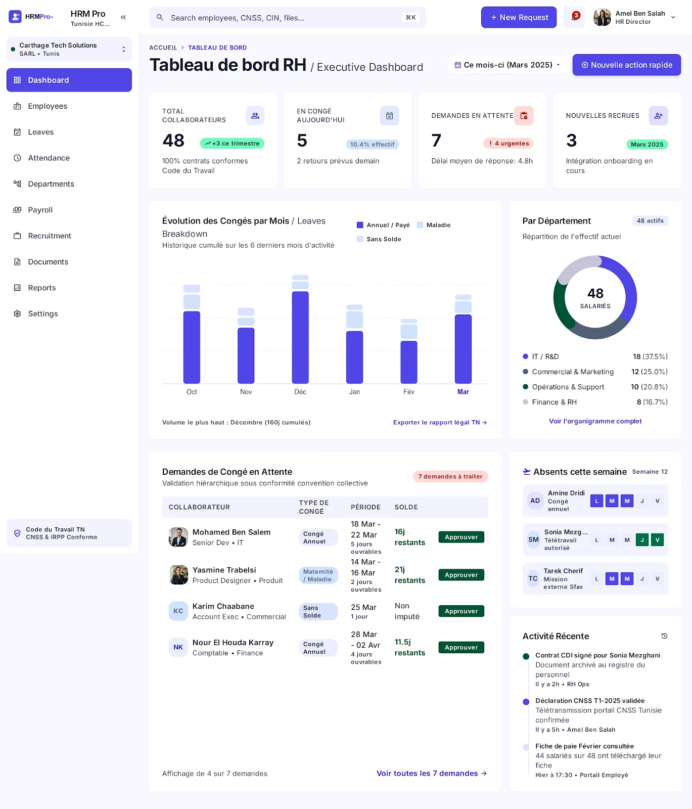
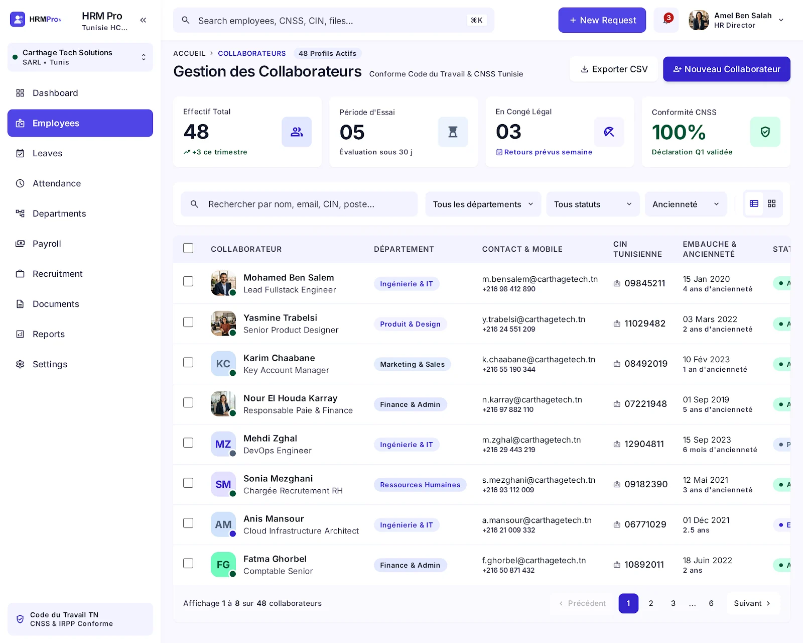
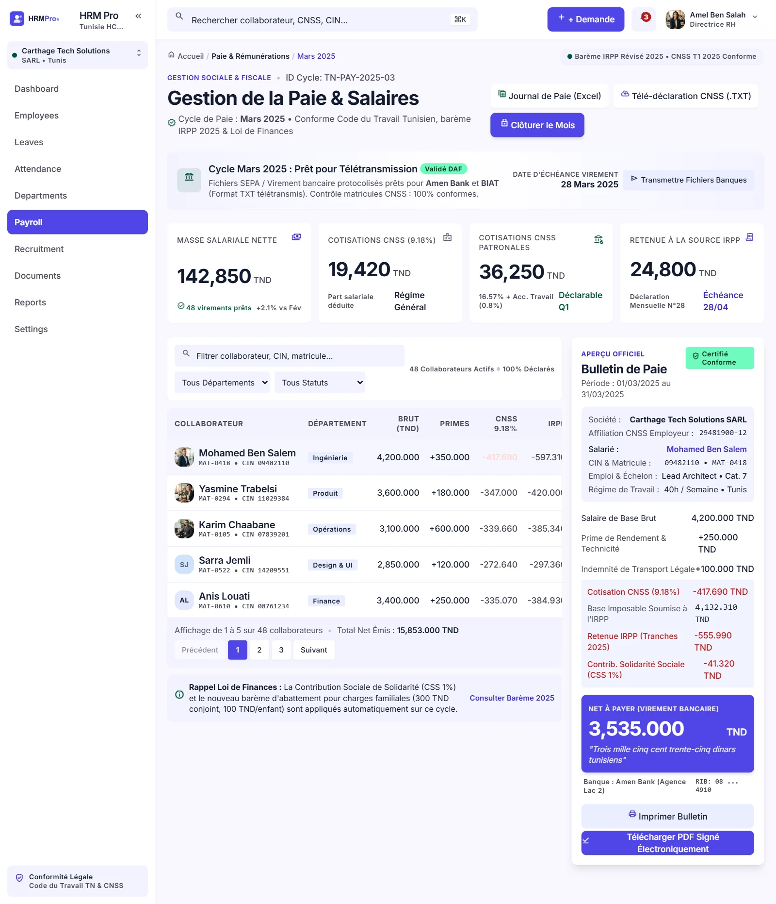

<p align="center">
  
</p>

<p align="center">
  
</p>

<p align="center">
  
  
  
  
</p>

## Overview

A Laravel and Blade HR management module covering the employee lifecycle: a central directory, leave requests with hierarchical validation, attendance, payroll, recruitment, document management, departmental reports and role-based access. The workflows follow Tunisian labour-code and CNSS declaration requirements.

## Highlights

- Employee directory with position, contact and document records
- Leave requests with hierarchical approval workflow
- Attendance tracking and payroll preparation
- Recruitment pipeline and candidate follow-up
- Departmental reports and role-based access control
- Blade + Tailwind interface built for data-dense daily use

## Tech stack

<p align="center">
  
</p>

## Screenshots

<p align="center">
  <a href="docs/screenshots/employees.webp"></a>
  <a href="docs/screenshots/leave.webp"></a>
  <a href="docs/screenshots/reports.webp"></a>
</p>

## Getting started

**Prerequisites:** PHP 8.2+, Composer, Node.js 20+ and MySQL.

```bash
composer install
npm install
cp .env.example .env
php artisan key:generate
# configure DB_* in .env, then:
php artisan migrate
npm run build
php artisan serve
```

## Documentation

- [Original project documentation](docs/README_ORIGINAL.md)

---

<p align="center">
  
</p>

<p align="center">
  Built by <a href="https://github.com/Skander-Bardaoui"><b>Skander Bardaoui</b></a> ·
  <a href="https://skander-bardaoui.netlify.app/">Portfolio</a> ·
  <a href="https://github.com/Skander-Bardaoui?tab=repositories">All repositories</a>
</p>
